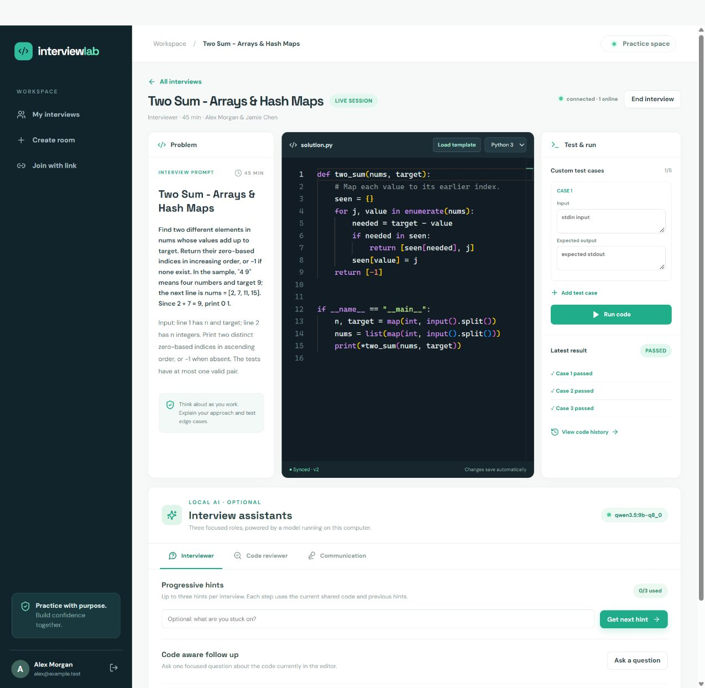
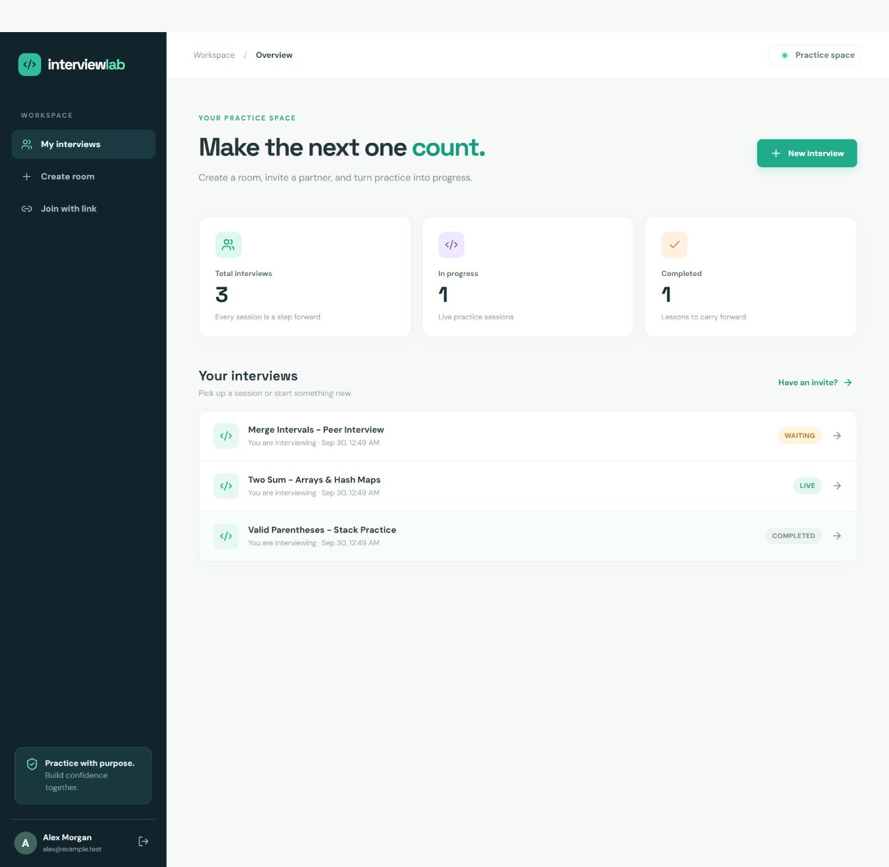
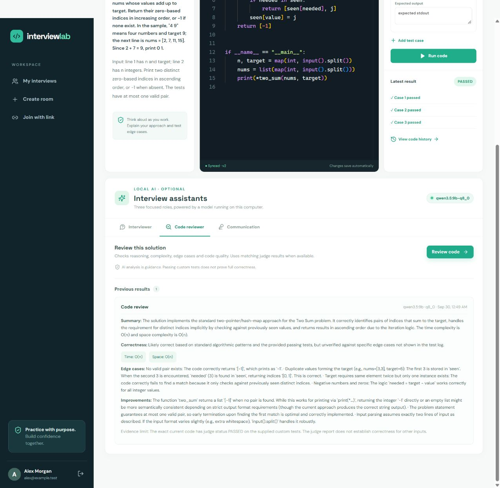
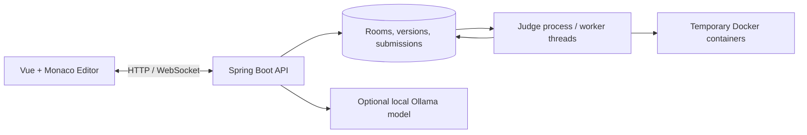

# InterviewLab

**Real-time collaborative coding and mock interviews, from the first line of code to the final feedback.**

[](https://github.com/000NK000/interviewlab/actions/workflows/ci.yml)

InterviewLab is an independent software engineering project for practicing technical interviews with a partner. An interviewer creates a room and shares an invitation; both participants work in a shared editor, run Java or Python code, and review the session afterward. Optional local AI assistants provide hints, code reviews, and feedback on interview notes.

The engineering focus is on concurrent edits, durable asynchronous jobs, recovery after worker failure, access control, and resource-limited code execution.

**Stack:** Java 17 · Spring Boot · PostgreSQL / H2 · WebSocket · Docker · Vue 3 · Monaco Editor · Ollama

## See it in action

These screenshots show the application running locally with example accounts and practice sessions. The execution result comes from the Docker judge; the AI review comes from a locally running model.

### Collaborative interview workspace

A shared editor, a problem statement, and test results in one workspace.



### Interview dashboard

Create a room, invite a partner, and revisit ongoing or completed interviews.



### Optional local AI review

An interviewer can request a review of the current code, informed by matching execution results.



## What you can do

- **Run a mock interview:** register, create a room, invite a candidate, start the session, and record a score and feedback when it ends.
- **Collaborate in real time:** synchronize code and cursors, reconnect after a disconnection, detect stale edits, and replay saved code versions.
- **Execute code:** submit Java or Python programs to an asynchronous judge with bounded concurrency, timeouts, and container resource limits.
- **Practice with curated problems:** choose from nine problems with sample cases, hidden cases, and starter templates, or write a custom prompt.
- **Use optional local AI:** request progressive hints, code-aware follow-up questions, a code review, or an evaluation of written communication notes.

## Engineering design



- **Room access:** session-cookie authentication, BCrypt password hashing, hashed invitation tokens, and role checks for room operations.
- **Edit consistency:** version checks and transactional updates reject stale writes instead of silently overwriting newer code.
- **Durable execution:** database-backed submissions, idempotency keys, bounded worker concurrency, and queue admission control.
- **Failure recovery:** workers claim jobs with renewable leases. Expired jobs can be retried after a process failure; execution has **at-least-once** semantics.
- **Execution limits:** containers run without network access and with CPU, memory, process, output, filesystem, and time limits. Containers are removed after execution.

## Measured local results

| Scenario | Verified result |
| --- | --- |
| 100 rooms with 200 simultaneous simulated WebSocket clients | All rooms passed code and cursor synchronization checks; **27 ms p95** code synchronization latency |
| 64 concurrently submitted jobs with four worker threads | **64/64 passed**; approximately **4.5 jobs/s** across the measured batch |
| Judge process terminated and restarted | **16/16 jobs recovered**; **17.65 seconds** from termination to all jobs completing |

These are short, reproducible **local tests**, not production traffic or a sustained throughput claim. Judge tests used PostgreSQL, one API process, and a separate judge process with four worker threads. The WebSocket test used H2 and a barrier that kept all clients connected before measurement.

See the [benchmark methodology, environment, and raw evidence](docs/benchmark.md).

## Run locally

### Prerequisites

- Java 17 and Maven 3.6+
- Node.js 22.12+ and npm
- Docker, running and accessible from the backend process
- Ollama, only if you want to use the AI assistants

```bash
git clone https://github.com/000NK000/interviewlab.git
cd interviewlab
docker pull python:3.12-alpine
docker pull eclipse-temurin:17-jdk-alpine
```

Start the backend in one terminal:

```bash
cd backend
mvn spring-boot:run
```

Start the frontend in a second terminal, from the repository root:

```bash
cd frontend
npm ci
npm run dev
```

Open **http://localhost:15173**. The API listens on port **18080**, and the management endpoint uses port **18081**. The default local profile stores data in an H2 file under `backend/data`; PostgreSQL is also supported.

### Try a complete interview

1. Register an interviewer account and create a room using a curated problem.
2. Open another browser profile, register a candidate account, and join using the invitation link.
3. Start the interview from the interviewer account. Load a template, edit the solution, and run the tests.
4. Review code history, end the interview, and save feedback. If Ollama is available, try the AI assistants as well.

See [local development](docs/local-development.md) for PostgreSQL, a separate judge process, local AI setup, configuration, and API endpoints.

## Verify the project

Backend tests:

```bash
cd backend
mvn -B verify
```

Frontend production build:

```bash
cd frontend
npm ci
npm run build -- --configLoader runner
```

[GitHub Actions](.github/workflows/ci.yml) runs the backend tests and frontend build. The repository also includes [API smoke tests](scripts/smoke.ps1), [curated-problem judge checks](scripts/curated-smoke.mjs), and [load and recovery test instructions](docs/benchmark.md).

## Explore the implementation

| Area | Starting point |
| --- | --- |
| Room lifecycle, authorization, and code versions | [RoomService.java](backend/src/main/java/dev/interviewlab/RoomService.java) |
| Durable queue, worker leases, and Docker execution | [JudgeService.java](backend/src/main/java/dev/interviewlab/JudgeService.java) |
| Real-time code and cursor events | [RoomSocket.java](backend/src/main/java/dev/interviewlab/RoomSocket.java) |
| Local AI roles and execution evidence | [AiService.java](backend/src/main/java/dev/interviewlab/AiService.java) |
| Simultaneous-client synchronization benchmark | [MultiRoomLoadTest.java](backend/src/test/java/dev/interviewlab/MultiRoomLoadTest.java) |
| Deployment design and operating considerations | [Deployment guide](docs/deployment.md) |

## Current scope

- The verified deployment is local. Session and WebSocket coordination run in a single API process; restarting it requires users to sign in again. Cloud deployment and multiple API instances are future work.
- The Docker judge is intended for a small, trusted practice group. Its resource limits are not a complete isolation boundary for an anonymous public code-execution service; see the [deployment guide](docs/deployment.md) before exposing it.
- Curated hidden tests are withheld from the candidate interface, but are visible in this public source repository.
- Local AI is optional and can make mistakes. Communication evaluation uses written notes or supplied transcript text; audio recording and speech transcription are not included.
