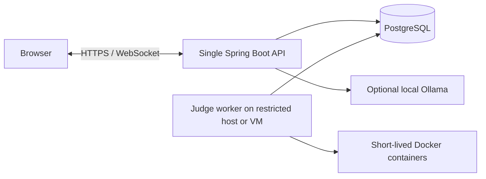

# InterviewLab 部署与监控边界

## 当前可运行拓扑

API 设置 `JUDGE_WORKERS=0`，worker 设置 `JUDGE_WORKERS=2`，两者连接相同 PostgreSQL。worker 的 `PORT=0`、`SERVER_ADDRESS=127.0.0.1`，不暴露 HTTP 接口。仅 worker 主机需要 Docker CLI/daemon 权限；不要把 Docker socket 挂载给公网 API。PostgreSQL 仅对 API 与 worker 所在的私有网络开放，凭据使用部署环境提供的密钥配置，不提交到仓库。

这套拓扑已经在同一台机器的两个 Java 进程和 PostgreSQL 上通过 worker 强制终止恢复验证；尚未在跨主机环境运行。API 登录会话及 WebSocket 连接仍保存在单个 API 进程中，因此此版本只运行一个 API 副本。若要横向扩容 API，需要先实现共享会话、跨实例事件分发和负载均衡的 WebSocket 连接策略。不要把多 worker 与多 API 混为一谈。

## 指标与告警

应用在独立的 `METRICS_PORT` 输出 `/actuator/health` 和 `/actuator/prometheus`，默认绑定 `127.0.0.1`。API 与 worker 各自提供：

- `interviewlab_judge_pending`：数据库中排队的数量；由于两个进程都读同一数据库，聚合图表只能选择一个实例，不能把实例值求和。
- `interviewlab_judge_running`：数据库中运行中的数量，同样不能跨实例相加。
- `interviewlab_judge_submissions_total`、`interviewlab_judge_completed_total{status=...}`：本进程接收和完成的数量，跨实例汇总时可以求和。
- `interviewlab_judge_queue_wait_seconds`、`interviewlab_judge_execution_seconds`：排队与执行时间。
- `interviewlab_websocket_connections`：当前进程 WebSocket 连接数。

最先观察：排队数持续上涨、错误或超时比例上升、执行时间 p95 上升、worker 健康检查失败。告警阈值应从真实负载基线确定，目前没有生产数据支持固定阈值。Actuator 端口应留在内网并由监控系统采集。

## 公开部署前尚需完成

当前 Docker 限制适合本地练习与可信小范围试用。若接收不可信公众代码，需进一步隔离判题主机/VM、采用受限账号与最小 Docker 权限、固定镜像摘要、限制出口流量、设置系统级配额和审计，并进行安全评估。短生命周期容器不等于完整安全边界。对外服务还需 TLS、`SECURE_COOKIE=true`、精确 `APP_ORIGIN`、注册和提交速率限制、持久备份及恢复演练。

GitHub Actions 当前执行后端测试、前端构建，并上传 JAR 与静态页面构建产物。仓库没有云环境凭据或发布目标，因此不会自动部署到 AWS；跨主机部署和公网压力数据都不能写成已完成的项目成果。
