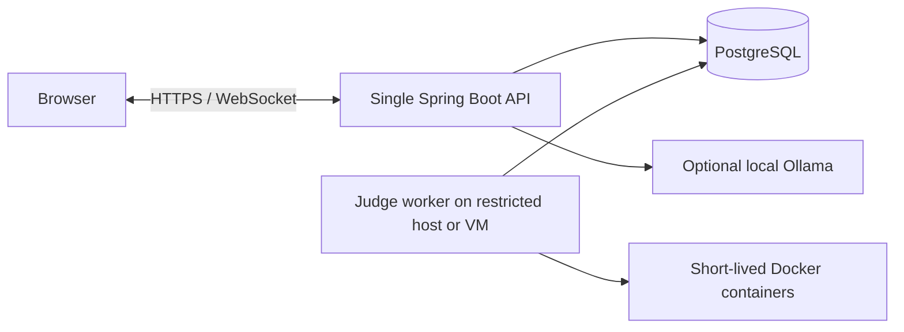

# InterviewLab Deployment and Monitoring

## Deployment topology

Set `JUDGE_WORKERS=0` for the API and `JUDGE_WORKERS=2` for the separate judge process, with both connecting to the same PostgreSQL database. The judge JVM runs two worker threads in this configuration; the expanded benchmark uses four threads in one judge JVM alongside one API JVM. Set `PORT=0` and `SERVER_ADDRESS=127.0.0.1` for the judge process so its HTTP listener uses an ephemeral port on loopback only. Only the judge host needs access to the Docker CLI and daemon. Do not mount the Docker socket into an API container exposed to the public Internet. PostgreSQL should be accessible only from the private network used by the API and judge. Supply credentials through the deployment environment's secret configuration and keep them out of the repository.

The separate-process topology has passed recovery tests after forced judge-process termination using two Java processes and PostgreSQL on one machine. It has not been tested across hosts. API login sessions and WebSocket connections remain in the single API process, so this version runs one API replica. Scaling the API horizontally requires shared sessions, event distribution across instances, and a load-balancing strategy for WebSocket connections. Multiple judge workers do not provide these API scaling capabilities.

The diagram shows the intended HTTPS boundary for external access. Local development uses HTTP; public hosting still requires the measures below.

## Metrics and alerts

The application exposes `/actuator/health` and `/actuator/prometheus` on a separate `METRICS_PORT`, bound to `127.0.0.1` by default. The API and judge processes each expose:

- `interviewlab_judge_pending`: the number of queued jobs in the database. Both processes read the same database, so dashboards must select one instance for this gauge rather than sum the values.
- `interviewlab_judge_running`: the number of running jobs in the database. This gauge must also not be summed across instances.
- `interviewlab_judge_submissions_total` and `interviewlab_judge_completed_total{status=...}`: submissions received and jobs completed by the current process. These counters may be summed across instances.
- `interviewlab_judge_queue_wait_seconds` and `interviewlab_judge_execution_seconds`: queue wait and execution durations.
- `interviewlab_websocket_connections`: active WebSocket connections in the current process.

Initial monitoring should focus on sustained queue growth, rising error or timeout rates, increasing p95 execution duration, and failed judge health checks. Set alert thresholds from measured workload baselines; there is no production dataset supporting fixed thresholds yet. Keep Actuator ports on a private network and collect them through the monitoring system.

## Requirements before public deployment

The current Docker limits support local practice and small trials with trusted participants. Accepting untrusted public submissions requires additional isolation for the judge host or VM, restricted accounts and minimal Docker privileges, image pinning by digest, egress restrictions, system-level quotas, auditing, and a security assessment. Short-lived containers alone do not provide a complete security boundary. Public hosting also requires TLS, `SECURE_COOKIE=true`, an exact `APP_ORIGIN`, registration and submission rate limits, durable backups, and recovery drills.

GitHub Actions currently runs backend tests, builds the frontend, and uploads the JAR and static build artifacts. The repository has no cloud credentials or deployment target, so this workflow does not automatically deploy to AWS. Cross-host deployment and public Internet load testing remain unvalidated.
